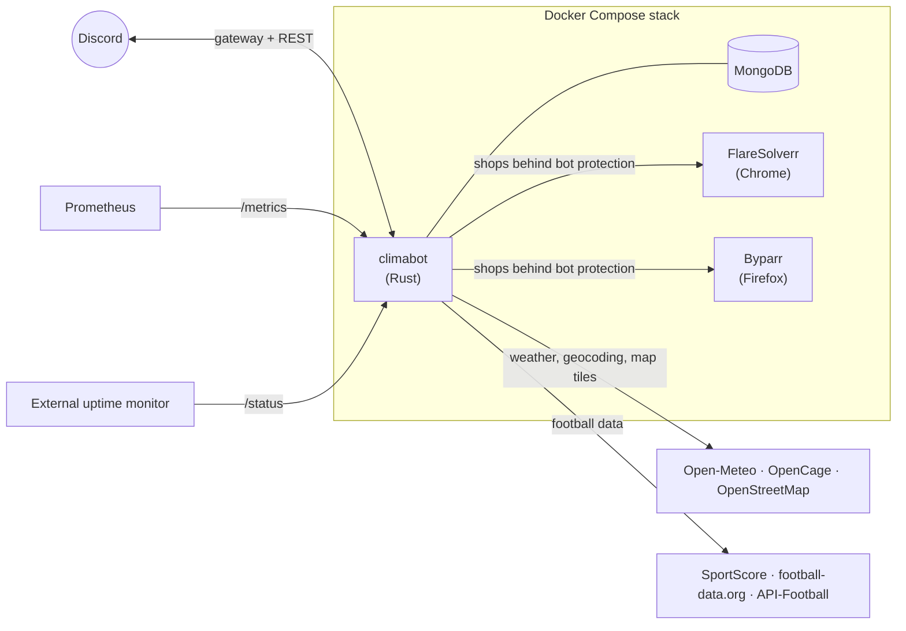
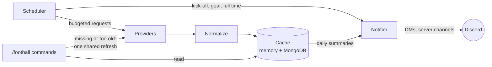

<a name="readme-top"></a>

<div align="center">

# 🌦️ ClimaBot

**A Discord bot for weather, live football, self-assignable roles and product price tracking.**

[](https://www.rust-lang.org/)
[](https://github.com/viniciussaporto/ClimaBot/actions/workflows/ci.yml)
[](https://discord.com/api/oauth2/authorize?client_id=1109598244884979792&permissions=534723951680&scope=applications.commands%20bot)
[](docker-compose.yml)
[](LICENSE.md)

[**Add it to your server**](https://discord.com/api/oauth2/authorize?client_id=1109598244884979792&permissions=534723951680&scope=applications.commands%20bot)
· [Report a bug](https://github.com/viniciussaporto/ClimaBot/issues)
· [Request a feature](https://github.com/viniciussaporto/ClimaBot/issues)


</div>

<details>
  <summary><b>Contents</b></summary>

- [Features](#features)
- [Commands](#commands)
- [How it works](#how-it-works)
  - [Architecture](#architecture)
  - [Weather](#weather)
  - [Football](#football)
  - [Price tracking](#price-tracking)
  - [Roles](#roles)
  - [Data storage](#data-storage)
- [Self-hosting](#self-hosting)
- [Configuration](#configuration)
- [Operations](#operations)
- [Development](#development)
- [Credits](#credits)
- [Contributing](#contributing)
- [License and contact](#license-and-contact)

</details>

## Features

| | |
| --- | --- |
| 🌦️ **Weather** | Current conditions with an animated precipitation map (now plus the next 3 hours), and a 5-day forecast, for any place on Earth, in metric or imperial units. |
| ⚽ **Football** | Live scores, fixtures, results, tables, top scorers, match events, line-ups, teams, squads, head-to-head, player careers and injuries. Follow teams and competitions for a personal feed and optional DM alerts; moderators can post daily summaries and live alerts in a channel. Covers the Brasileirão, Copa do Brasil, Libertadores, Sudamericana, Brazilian state championships and the main European leagues and cups. |
| 🎭 **Roles** | A menu members use to pick their own roles. Roles that would be risky to hand out are never offered. |
| 📦 **Price tracking** | Watch product pages in any currency and get a DM when the price changes. |
| 🛠️ **Built to run unattended** | Prometheus metrics, a `/status` health endpoint, Grafana dashboards and alerts as code, JSON logs for Loki, a self-check command and a nightly self-update. |

## Commands

All commands are slash commands, grouped so that typing `/` shows only five: `/weather`, `/football`, `/roles`, `/pt` and `/help`. Options in `<angle brackets>` are required, `[square brackets]` optional. Football options autocomplete as you type, and buttons and menus under the replies switch views, so IDs never need typing.

### Weather

| Command | What it does |
| --- | --- |
| `/weather now <location> [units]` | Temperature, feels-like, humidity, clouds, wind and pressure, with an animated map of rain, snow and thunderstorms around the location |
| `/weather forecast <location> [units]` | 5-day forecast: highs, lows and chance of rain (dates are day-first, e.g. `Tue, 29/09`) |

`units` is **Metric** (°C, km/h, hPa) by default, or **Imperial** (°F, mph, inHg).

### Football

`/football live` is refreshed every minute during matches. Every other reply comes from the cache, says how old its data is, and is never presented as live.

| Command | What it does |
| --- | --- |
| `/football live all [competition]` | Every live match in the followed competitions, grouped by competition |
| `/football live competition <competition>` | Live matches in one competition |
| `/football live match <match>` | One live match: score, status, clock and the latest events |
| `/football competition list` | The competitions followed, and what is available for each |
| `/football competition fixtures <competition> [date]` | Matches and results on a day: `today` (default), `tomorrow`, `yesterday` or `YYYY-MM-DD` |
| `/football competition table <competition>` | Standings, or one table per group for competitions with groups |
| `/football competition scorers <competition> [stat]` | Top goalscorers, or top assists |
| `/football match details\|events\|lineup\|stats <match>` | Summary, full timeline, line-ups, team statistics; buttons switch between them |
| `/football team info <team>` | League positions, form, recent results, next matches |
| `/football team fixtures <team>` | All recent results and upcoming matches |
| `/football team squad <team>` | Current registered players, by position |
| `/football team injuries <team>` | Squad menu to check each player's availability (see [injuries](#injuries-careers-and-their-limits)) |
| `/football team stats <team> <competition>` | The team's record in a competition: points, goals, per-game averages, form |
| `/football team compare <team> <other>` | Head-to-head record, recent meetings, positions and form side by side |
| `/football player stats <name>` | This season's statistics |
| `/football player career <name>` | Clubs and national teams by season, season statistics, transfers, trophies |
| `/football player injuries <name>` | Availability, current absence with its expected return, past injuries and suspensions |
| `/football follow team <team>` | Follow or unfollow a team (also the **⭐ Follow** button under a team) |
| `/football follow competition <competition>` | Follow or unfollow a competition |
| `/football follow manage` | Menus and buttons for what you follow and your DM alerts (off by default) |
| `/football follow feed` | Live, today's and upcoming matches, yesterday's results and table changes for what you follow |
| `/football server setup` | Moderators: channel, competitions, time and on/off switches for server posts (off by default) |
| `/football server team <team>` | Moderators: add or remove a team the server follows |
| `/football server preview` | The daily summary this server would get |

### Roles, price tracking and help

| Command | What it does |
| --- | --- |
| `/roles` | Menu to toggle self-assignable roles (servers only) |
| `/pt add <url>` | Start tracking a product page |
| `/pt list` | Your tracked products, current prices and next check time |
| `/pt history <item>` | A product's price history, with its lowest and highest price |
| `/pt remove <item>` | Stop tracking a product |
| `/help <topic>` | `/help overview` for all commands, or how one works, where its data comes from and how its reply is built: `/help weather`, `forecast`, `live`, `football`, `follow`, `server`, `roles`, `pt`, `about`. `/help server` walks moderators through setting up server posts; `/help status` shows live health of the bot and every API, and how much of each limit is used today |

For `/pt history` and `/pt remove`, `item` is the position shown by `/pt list`, or the product URL.

## How it works

### Architecture

ClimaBot is one Rust binary ([serenity](https://github.com/serenity-rs/serenity) for Discord, [tokio](https://tokio.rs) for async), deployed as a Docker Compose stack:



- **Networks:** MongoDB sits on an internal network only the bot can reach. The browsers have internet access but can't reach MongoDB or the monitoring stack. Prometheus scrapes the bot over a shared `climabot-monitoring` network.
- **Gateway intents:** only `GUILDS`. Slash commands and components need no privileged intents.
- **Background jobs:** the price-check scheduler, the football scheduler and notifier, gateway latency sampling and the `/status` probes run as tokio tasks inside the bot process.
- **Images:** the Docker image builds with OpenSSL (native-tls) and runs as an unprivileged user (uid 10001).

### Weather

1. [OpenCage](https://opencagedata.com) turns the location into coordinates.
2. [Open-Meteo](https://open-meteo.com) provides the current conditions and the 5-day forecast.
3. The **precipitation map** is a 480×360 animated GIF covering about 290 × 220 km around the location:
   - **Basemap:** [OpenStreetMap](https://www.openstreetmap.org/copyright) tiles at zoom 8, darkened so the precipitation stands out. Tiles are cached for a week, as the OSM tile policy asks.
   - **Precipitation:** Open-Meteo forecasts on a 12 × 9 grid of points. The first frame is now, then one frame for each of the next 3 hours. Values are interpolated bicubically and drawn as a soft colour gradient from 0.1 to 16+ mm/h, with a colour scale. Snow is drawn whiter, and thunderstorms get a ⚡.
   - **Budget:** one map costs about 108 Open-Meteo calls. The grid is only fetched when precipitation is likely at the location: it's raining now, rain is forecast in the next hours, or the chance of rain reaches `RADAR_RAIN_CHANCE` %. Otherwise the map is drawn dry and costs nothing. Maps are cached for 10 minutes.
   - **No map:** if the map can't be built in time, the weather embed is sent without it.

### Football

Data sources:

| Source | Used for | Free-tier limits |
| --- | --- | --- |
| [SportScore](https://sportscore.com/developers/) | Everything, including live scores, match events and line-ups. The primary source. | About 10,000 requests/day per IP. Attribution is required. |
| [football-data.org](https://www.football-data.org/) | Backup for fixtures, tables and scorers of its 13 free competitions. Its free-tier scores are delayed, so it is never used for live scores. | 10 requests/minute |
| [API-Football](https://www.api-football.com/) | Squads, player careers, transfers, trophies and injury histories. Its free plan can't read current-season fixtures, injuries or player statistics. | 100 requests/day |

**Competitions** (defined in [`src/football/competitions.rs`](src/football/competitions.rs)):

- **Brazil:** Brasileirão Séries A, B and C, Copa do Brasil, Supercopa do Brasil, Copa do Nordeste, Copa Verde, Paulistão, Carioca, Mineiro, Gaúcho
- **South America:** Copa Libertadores, Copa Sudamericana
- **UEFA:** Champions League, Europa League, Conference League
- **England, Spain, Germany, Italy, France, Portugal:** the top league and the main domestic cups of each

**Data flow.** Commands never call the providers per user:



- **The scheduler** is the only routine caller:
  - Fixture lists for today and tomorrow every 6 hours. Once a day: yesterday's results, the fixtures of the week ahead, every table (keeping yesterday's for position changes) and the schedules of followed teams.
  - The live scoreboard about once a minute, but only while a followed match is about to start, under way or just ended. SportScore caches responses for 60 s, so polling faster gains nothing.
  - Match details every 2.5 minutes for live matches in the ⭐ priority competitions (`FOOTBALL_PRIORITY`), and for matches someone asked about in the last 20 minutes.
  - When a match leaves the live list, its final score, its competition's fixture list and its table are refreshed once.
  - Changes between two live scoreboards (kick-offs, goals) and verified final scores go to the notifier.
- **Commands** read the cache: memory first, then the `football_cache` collection in MongoDB, which survives restarts. If the data is missing or too old, they trigger a refresh. There is only one refresh per resource at a time, however many users ask.
- **Budgets:** each provider has a daily request budget and a per-minute pace. Usage is persisted, so a restart doesn't reset it, and is corrected from the provider's own quota headers. As a budget runs low, optional work (tables, details) stops first and the live scoreboard last; part of the budget is kept for user requests.
- **Failures:** rate limits, outages and rejected keys put the provider into a cooldown with exponential backoff, and the bot falls back to the backup source where one exists.
- **Honest replies:**
  - Every reply names its source and shows when the data was fetched.
  - If a refresh failed, the reply says so and shows the last saved copy with its age.
  - If nothing is cached, the reply says the data is unavailable.
  - Missing line-ups or statistics are reported as "not provided by the current data source". Data is never made up.

**Following and notifications.** Users follow up to 25 teams and any competitions; a server, configured by its moderators, follows its own. The feed and the daily summary are built from the cache only, and live alerts come from the scheduler's scoreboard changes, so following more doesn't add requests.

- **Everything is off by default.** A user switches on their own daily DM and live-alert DMs in `/football follow manage`; the bot sends a test DM first and refuses if DMs are closed. Server posts stay off until a moderator picks a channel and switches them on in `/football server setup`.
- **Moderators** are members with Manage Server, Manage Channels, Moderate Members or Administrator. Others can only preview.
- **Daily summary:** at the chosen UTC hour, once a day (remembered across restarts). **Live alerts:** kick-off, goals and full time, grouped into one message per update.

**Injuries, careers and their limits.** These come from API-Football's free plan, which has no current-season injury list or player statistics:

- **Injuries and suspensions** are read from each player's absence history (type, start, end or expected return). `/football team injuries` shows a menu of the squad to check players one by one; a whole-squad check would cost a day's requests. Coverage of Brazilian competitions is often incomplete, and suspensions for accumulated cards are usually missing: the reply warns when the newest entry is over a year old.
- **Careers:** clubs and national teams by season, transfers with fees and trophies are complete; per-season statistics cover 2022–2024 only, and national-team appearance counts aren't available.
- Each player costs a few requests the first time and is then cached for weeks.

### Price tracking

- **Schedule:** each user can track up to 25 products. Every product is checked about once an hour, at a random time within ±15 minutes of its hourly slot. Requests to the same shop are spaced randomly, so the traffic doesn't look scheduled.
- **Notifications:** when the price changes, ClimaBot DMs the owner with the old and new price and the change in percent. If a page can't be read for 24 hours in a row, it sends a one-time warning instead. Both messages have a **❌ Stop tracking** button.
- **Tested shops:** KaBuM, Amazon Brasil, Magazine Luiza, Pichau, Terabyte and AliExpress. Other shops may work, but that isn't guaranteed.

**How pages are fetched.** A direct request is tried first, then two challenge-solving browsers that also render JavaScript:

1. [FlareSolverr](https://github.com/FlareSolverr/FlareSolverr) (Chrome): handles Akamai and many Cloudflare pages.
2. [Byparr](https://github.com/ThePhaseless/Byparr) (Firefox): handles Cloudflare challenges FlareSolverr can't.

- **Fetch method:** the method that last worked for a shop is tried first next time, and is remembered across restarts.
- **Extraction:** prices are read from schema.org data, product meta tags, dedicated rules for Amazon and AliExpress, or common price markup.
- **Failures:** when `/pt add` can't read a price, the shop is recorded in the `failed_sites` collection for later investigation (`climabot failed-sites`).
- **Shops that block servers:** some shops refuse datacenter IPs whatever the browser does, Mercado Livre's website for example. Set `SCRAPER_PROXY` to a residential proxy for those. For Mercado Livre you can instead set `ML_CLIENT_ID` / `ML_CLIENT_SECRET` from a free [Mercado Livre developer app](https://developers.mercadolivre.com.br) to use the official API.
- **Regional prices:** shops that adapt to the visitor's country, such as AliExpress, show prices for the server's (or proxy's) country.

### Roles

`/roles` shows a paginated menu of roles members can toggle themselves. These roles are never offered:

- roles with moderation or administrator permissions
- managed roles (bots, integrations, boosts)
- `@everyone`
- roles at or above the bot's own highest role

The bot needs the **Manage Roles** permission.

### Data storage

Everything lives in one MongoDB database (`MONGODB_DB`, default `climabot`):

| Collection | Contents |
| --- | --- |
| `products`, `price_history` | Tracked products, their schedule and every observed price |
| `fetch_methods`, `failed_sites` | Which fetch method works per shop; shops where `/pt add` found no price |
| `football_cache` | The latest normalized result of every football request, with source and fetch time; expires through a TTL index |
| `football_usage`, `football_provider_health` | Requests per provider and UTC day; each provider's last known state |
| `football_team_map` | Which API-Football team id each team is |
| `football_follows` | What each user and server follows, their notification switches (all off by default), summary hour, server channel |

## Self-hosting

**Requirements:** Docker with Compose v2, and about 4 GB of RAM (the two browsers are the heavy part).

1. Create an application in the [Discord Developer Portal](https://discord.com/developers/applications) and copy its bot token. Invite it with the `bot` and `applications.commands` scopes and the **Manage Roles** permission. No privileged gateway intents are needed.
2. Get a free API key from [OpenCage](https://opencagedata.com).
3. Optional, for football:
   - A free [football-data.org](https://www.football-data.org/client/register) token.
   - A free [API-Football](https://dashboard.api-football.com/register) key.
   - A registered [SportScore](https://sportscore.com/developers/) key. SportScore also works without one.
4. Configure:
   ```sh
   cp .env.example .env    # then fill in DISCORD_TOKEN, OPENCAGEAPIKEY and any optional keys
   ```
5. Create the network shared with your monitoring stack (once). Attach Prometheus to it if you use one:
   ```sh
   docker network create climabot-monitoring
   ```
6. Start everything:
   ```sh
   docker compose up -d --build
   ```
7. Check the deployment:
   ```sh
   docker compose exec climabot climabot selfcheck [product-url ...]
   ```
   The self-check doesn't touch the gateway. It covers:
   - the Discord token, registered commands and role menus per server
   - the weather, map and football APIs
   - a MongoDB round trip in a scratch database
   - the browsers, and scraping any product URLs you pass

   Each item prints `[ OK ]`, `[FAIL]` or `[SKIP]`.

Global slash commands are registered on every start. Discord can take a few minutes to show new ones.

## Configuration

Everything is set in `.env`. [`.env.example`](.env.example) documents every option.

**Required**

| Variable | Purpose |
| --- | --- |
| `DISCORD_TOKEN` | Bot token (`TOKEN` is also accepted) |
| `OPENCAGEAPIKEY` | OpenCage geocoding key, for `/weather` |

**Weather**

| Variable | Default | Purpose |
| --- | --- | --- |
| `RADAR_RAIN_CHANCE` | `20` | Fetch the precipitation grid (~108 Open-Meteo calls) only when the chance of precipitation at the location reaches this % within 3 hours |

**Football**

| Variable | Default | Purpose |
| --- | --- | --- |
| `SPORTSCORE_API_KEY` | – | Registered SportScore key. Optional: raises their rate limit. |
| `FOOTBALL_DATA_TOKEN` | – | football-data.org token: backup source for fixtures, tables and scorers |
| `API_FOOTBALL_KEY` | – | API-Football key: squads (`/football team squad`) |
| `FOOTBALL_PRIORITY` | the ⭐ competitions | Comma-separated competition keys whose live match details are polled, e.g. `brazilian-serie-a,conmebol-copa-libertadores` |
| `SPORTSCORE_DAILY_BUDGET` | `9000` | SportScore requests per UTC day the bot allows itself |
| `SPORTSCORE_PER_MINUTE` | `300` | SportScore requests per minute (their free tier allows about 15 per second) |
| `FOOTBALL_DATA_DAILY_BUDGET` | `5000` | football-data.org requests per UTC day |
| `API_FOOTBALL_DAILY_BUDGET` | `100` | API-Football requests per UTC day |

**Price tracking**

| Variable | Default | Purpose |
| --- | --- | --- |
| `FLARESOLVERR_URL` / `BYPARR_URL` | set by compose | Challenge-solving browsers; unset means not used |
| `FLARESOLVERR_CONCURRENCY` / `BYPARR_CONCURRENCY` | `1` | Pages each browser may load at once |
| `FLARESOLVERR_MEM_LIMIT` / `BYPARR_MEM_LIMIT` | `1536m` / `2g` | Browser memory caps (compose) |
| `SCRAPER_PROXY` | – | HTTP or SOCKS5 proxy for all scraping |
| `ML_CLIENT_ID` / `ML_CLIENT_SECRET` | – | Mercado Livre API app |

**Runtime**

| Variable | Default | Purpose |
| --- | --- | --- |
| `MONGODB_URI` / `MONGODB_DB` | set by compose | Database connection |
| `MONGO_CACHE_GB` | `0.25` | MongoDB WiredTiger cache size (compose) |
| `LOG_DIR` / `CLIMABOT_LOG_DIR` | `/var/log/climabot` | JSON logs, rotated daily, 7 days kept (in the container / on the host) |
| `METRICS_PORT` / `METRICS_HOST_PORT` | `9464` / `9465` | Port for `/metrics` and `/status`; the host side binds to `127.0.0.1` |
| `MONITORING_NETWORK` | `climabot-monitoring` | Docker network shared with Prometheus (compose) |
| `RUST_LOG` | `info` | Log level (`trace`, `debug`, `info`, `warn`, `error`) |

## Operations

This section describes how the reference deployment is run. The scripts in [`deploy/`](deploy) work on any Debian-like server with Docker.

### Branches and deploys

| Branch | Role |
| --- | --- |
| `main` | Production. The server deploys it on every update and nightly restart. |
| `preprod` | Changes land here first and reach production through a merge into `main`. |

Older versions are kept as the tags `archive/DeployThis` (the first Rust deployment branch) and `archive/javascript` (the retired TypeScript bot).

### The `climabot` command

`deploy/install.sh` installs a `climabot` command on the server, plus `climabot-*` shortcuts and an SSH login banner listing them. The checkout lives in `/root/climabot-rust` and follows `main`.

| Alias | Command | What it does |
| --- | --- | --- |
| `climabot-start` | `climabot start` | Pull `main`, rebuild the bot, pull the MongoDB and browser images, start the stack |
| `climabot-update` | `climabot update` | Pull `main`, rebuild and restart the running bot; rolls back if the new build doesn't come up |
| `climabot-stop` | `climabot stop` | Stop the bot and its stack |
| `climabot-status` | `climabot status` | Branch, commit and container status |
| `climabot-logs` | `climabot logs` | Follow the bot's logs |
| `climabot-failed-sites` | `climabot failed-sites` | Shops where `/pt add` couldn't find a price, most recent first |
| `climabot-help` | | Show the list again |

`climabot update` also runs:

- **nightly at 05:30 UTC** (`climabot-update.timer`), the quietest hour for the bot's users
- **3 minutes after every boot**, so a restarted server always comes back on the latest `main`

ClimaBot alerts are muted from 05:25 to 06:15 UTC around the nightly run.

**Rollback.** Before building, `climabot update` and `climabot start` keep the running image as `climabot:previous`. If the new container doesn't log in to Discord within about 90 seconds, the previous image is put back and restarted, and the command fails with the new build's logs. The Docker build itself refuses to produce an image whose binary doesn't answer `climabot --version`.

### Monitoring

- **Metrics:** Prometheus scrapes `climabot:9464/metrics`. Metric families:
  - `discord_*`: commands, response times, guilds, gateway latency
  - `weather_api_*`
  - `price_*`
  - `football_*`: requests by provider and outcome, budget used, provider health, live-scoreboard freshness, cache hits
- **Dashboards** are generated by [`deploy/grafana/build_dashboards.py`](deploy/grafana/build_dashboards.py). Run it, commit the JSON, and `climabot update` provisions them in the folders **ClimaBot** and **Infrastructure Metrics**.
- **Alerts** are generated by [`deploy/grafana/build_alerts.py`](deploy/grafana/build_alerts.py). Each rule has a summary, a description and a numbered runbook.
  - `alerting/urgent.yaml`: the bot, website, API, status page, certificates, disk and memory. Sent to **Telegram**.
  - `alerting/info.yaml`: restarts, error rates, price checks, football data (stale live scores, budget nearly used, provider failing), slow site and resources. Sent to **Discord** through a webhook URL in `/root/monitoring/secrets/discord-webhook-url`. Without that file, only the urgent alerts are installed.
- **Probes:** the blackbox exporter checks website uptime and TLS expiry ([`deploy/monitoring/blackbox.yml`](deploy/monitoring/blackbox.yml)).
- **Logs:** daily JSON files in `/var/log/climabot`, shipped to Loki as `{job="climabot", level="info|warn|error"}` and kept for 30 days. Query them in Grafana Explore, e.g. `{job="climabot", level="error"} | json`, or in the dashboard's **Logs** row.

### When Grafana itself is down

All the alerts above come from Grafana, so if Grafana or the whole server dies, nothing is sent. Two monitors on an external uptime service cover that, notifying the same Telegram chat. UptimeRobot, Better Stack or similar work, and free plans are enough.

| Monitor | URL | Healthy when |
| --- | --- | --- |
| ClimaBot | `https://vinisaporto.de/api/climabot/status` | HTTP 200 and the body contains `"ok":true` |
| Grafana | `https://grafana.vinisaporto.de/api/health` | HTTP 200 and the body contains `"database": "ok"` |

`/status` returns HTTP 200 with `{"ok":true,"discord":true,"database":true,"version":"…"}` when a shard is connected to Discord and MongoDB answers. Otherwise, and for about a minute after a start, it returns HTTP 503 with `"ok":false`.

The reverse proxy forwards only that path to the bot; `/metrics` stays private. Check every 5 minutes, alert after 2 failures, and add a maintenance window for the nightly update if the service supports one.

## Development

**Requirements:** Rust 1.88 or newer (the Docker build and CI use 1.100), plus OpenSSL headers (`pkg-config` and `libssl-dev` on Debian/Ubuntu). For `cargo run` you also need a MongoDB and a `.env`.

```sh
cargo build
cargo test                       # unit tests, offline: provider parsing uses saved responses
cargo run                        # runs the bot with .env
```

**Formatting and linting.** CI ([`.github/workflows/ci.yml`](.github/workflows/ci.yml)) runs these on every push to `main`/`preprod` and every pull request, and fails on any finding. Run them before pushing:

```sh
cargo fmt                                       # format (rustfmt.toml: 120 columns)
cargo clippy --all-targets -- -D warnings       # lints, configured under [lints] in Cargo.toml
cargo audit                                     # known vulnerabilities in Cargo.lock (RustSec)
ruff check deploy && ruff format --check deploy # the Grafana generators (ruff.toml)
shellcheck deploy/install.sh deploy/grafana/install.sh deploy/shell/climabot.sh deploy/climabot
```

| Tool | Configuration | What it enforces |
| --- | --- | --- |
| rustfmt | `rustfmt.toml` | Stable options only: 120 columns, `Max` width heuristics, field-init and `?` shorthands |
| Clippy and rustc | `[lints]` in `Cargo.toml` | Clippy's default and `pedantic` groups (a few noisy pedantic lints allowed, each with its reason), `unsafe_code` forbidden, `rust_2018_idioms`, `unused_qualifications` |
| Ruff | `ruff.toml` | pycodestyle, pyflakes, import order, bugbear, pyupgrade, simplifications and Ruff's own rules; Ruff's formatter |
| ShellCheck | inline directives | Every deploy script; intended exceptions are annotated where they occur |
| EditorConfig | `.editorconfig` | UTF-8, LF line endings, final newline, no trailing whitespace |
| cargo-audit | – | No dependency with a known vulnerability ([RustSec](https://rustsec.org/)); "unmaintained" notices are reported, not fatal |

CI also builds the Docker image (and runs `climabot --version` in it), and regenerates the Grafana dashboards and alerts, failing if the committed files differ from what the generators produce.

**Dependencies.** Dependabot ([`.github/dependabot.yml`](.github/dependabot.yml)) opens weekly update pull requests against `preprod`: Cargo patch and minor updates grouped in one, majors and GitHub Actions separately. Security alerts on `main` get their own updates as soon as they're published. The Rust version is upgraded by hand, in the Dockerfile and the CI workflow together, along with any new Clippy lints. The commit that first formatted the code is listed in `.git-blame-ignore-revs`, so `git blame` skips it (`git config blame.ignoreRevsFile .git-blame-ignore-revs` locally; GitHub does it automatically).

**Live tests.** These call the real APIs, so they are `#[ignore]`d by default:

```sh
# Every /football view against the real providers, checked against
# Discord's embed limits. Uses FOOTBALL_DATA_TOKEN / API_FOOTBALL_KEY if set.
cargo test live_football -- --ignored --nocapture --test-threads=1

# Career and injury views against API-Football (about 7 of its 100 daily requests)
cargo test live_injuries -- --ignored --nocapture

# Render a real precipitation map (plus a PNG per frame); RADAR_LAT / RADAR_LNG choose the place
RADAR_OUT=map.gif cargo test --release live_render -- --ignored --nocapture
```

**Debugging price extraction.** Save a product page and run:

```sh
cargo run -- extract page.html <url>     # or `climabot extract …` on the server
```

### Project layout

```text
src/
├── main.rs              Startup, Discord event handler, MongoDB connection
├── commands/            Slash commands
│   ├── mod.rs           Definitions and dispatch
│   ├── help.rs          /help and its topics
│   ├── weather.rs       /weather now, /weather forecast (OpenCage, Open-Meteo)
│   ├── radar.rs         The animated precipitation map
│   ├── football.rs      /football: rendering, autocomplete, buttons, pagination
│   ├── football_player.rs  Player careers and injuries, team injuries, head-to-head
│   ├── football_follow.rs  Following, server setup, the feed and the notifier
│   ├── roles.rs         /roles
│   └── pricetracking.rs /pt
├── football/            Football data service
│   ├── competitions.rs  The followed competitions
│   ├── model.rs         Provider-neutral types (fixtures, events, tables…)
│   ├── providers/       SportScore, football-data.org, API-Football adapters
│   ├── follows.rs       Who follows what (users and servers)
│   ├── quota.rs         Per-provider budgets, health, backoff
│   ├── scheduler.rs     Background refreshes and live polling
│   ├── store.rs         MongoDB persistence
│   └── testdata/        Saved provider responses for the parser tests
├── pricetracker/        Scheduler, scraping, browsers, currencies, MongoDB store
├── metrics.rs           Prometheus metrics and the /metrics + /status server
├── status.rs            Health probes for /status
├── selfcheck.rs         `climabot selfcheck`
└── logger.rs            Console + daily JSON log files
deploy/                  Server install script, systemd timer, Grafana dashboards and alerts
images/                  Weather icons used in the embeds
```

**Conventions**

- **Formatting:** `cargo fmt` for Rust and `ruff format` for Python; never hand-format against them. A lint you disagree with is allowed in the narrowest scope (`#[allow(...)]` on the item) with a comment saying why.
- **Football providers:**
  - Keep the provider's attribution on every view that shows its data. SportScore's free tier requires a visible link.
  - New fields from a provider are `Option`s: a missing field must never fail a whole reply.
  - When you change a parser, add or update a saved response in `src/football/testdata/`.

## Credits

- Weather data: [Open-Meteo](https://open-meteo.com) (CC BY 4.0)
- Geocoding: [OpenCage](https://opencagedata.com)
- Map tiles: © [OpenStreetMap](https://www.openstreetmap.org/copyright) contributors
- Football data: [Powered by SportScore](https://sportscore.com/), [football-data.org](https://www.football-data.org/), [API-Football](https://www.api-football.com/)
- Weather icons: [Icons8](https://icons8.com)

## Contributing

Suggestions and pull requests are welcome. Open an [issue](https://github.com/viniciussaporto/ClimaBot/issues) with the `enhancement` label, or:

1. Fork the project.
2. Create a branch from `preprod` (`git checkout -b feature/my-feature preprod`).
3. Make sure `cargo fmt --check`, `cargo clippy --all-targets -- -D warnings` and `cargo test` pass (CI checks them).
4. Push the branch and open a pull request into `preprod`.

## License and contact

Distributed under the MIT License; see [LICENSE.md](LICENSE.md).

Vinicius Saporto · [@viniciussaporto](https://twitter.com/viniciussaporto) · vinicius.saporto@gmail.com

<p align="right">(<a href="#readme-top">back to top</a>)</p>
